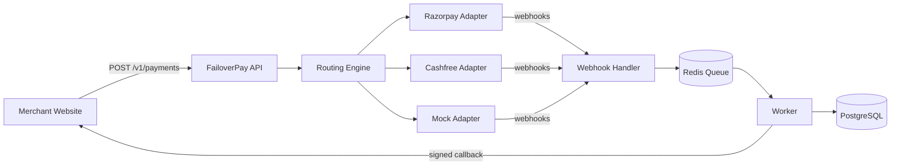

# FailoverPay

> A payment orchestration service that never lets a payment fail because one gateway went down. Integrate multiple gateways **once**, and let any number of websites use them through a single unified API with automatic failover.


## The Problem

Every website that accepts payments has to integrate each gateway separately (Razorpay, Cashfree, Stripe, ...). That means repeated integration code, repeated webhook handling, and a lot of rework whenever a gateway is added, replaced, or goes down. With several websites and several gateways, the effort multiplies.

## The Solution

FailoverPay sits between your websites and the payment gateways.

```
Website 1 ─┐
Website 2 ─┼──►  FailoverPay (unified API)  ──►  Razorpay adapter
Website 3 ─┤                           ──►  Cashfree adapter
Website 4 ─┘                           ──►  Mock adapter (testing)
                    ▲
                    └── Gateway webhooks return here
```

Connect each gateway to FailoverPay once. Each website then only talks to FailoverPay.

## Features

**Core**
- Unified API: `POST /v1/payments` works the same for every gateway
- Adapter pattern: add a new gateway by writing one adapter class
- Multi-tenant: every website (merchant) gets its own API key
- Idempotency keys to prevent duplicate charges
- Signature-verified webhook handling with duplicate-event protection

**Reliability**
- Rule-based and success-rate-based routing
- Automatic failover and retries on another gateway
- Circuit breaker for unhealthy gateways
- Reconciliation job to catch stuck or mismatched payments

**Operations**
- Refunds (full and partial) from one place
- Admin dashboard: transactions, per-gateway success rate, revenue per website
- Alerts when a gateway goes down
- Signed webhooks to merchants with exponential-backoff retries

## Tech Stack

| Layer | Technology |
|---|---|
| Backend | Node.js, Express.js (JavaScript) |
| Database | PostgreSQL + Prisma |
| Queue / Cache | Redis + BullMQ |
| Validation | Zod |
| Testing | Vitest, Supertest |
| Dashboard | React / Next.js |
| Infra | Docker Compose, GitHub Actions |

## Architecture



**Payment lifecycle**

```
CREATED → PENDING → SUCCESS → REFUNDED / PARTIALLY_REFUNDED
                  ↘ FAILED → retried on next gateway → PENDING
```

## Quick Start

**Prerequisites:** Node.js 20+, Docker

```bash
# 1. Clone
git clone https://github.com/<your-username>/failoverpay.git
cd failoverpay

# 2. Start Postgres and Redis
docker compose up -d

# 3. Setup the API
cd apps/api
cp .env.example .env
npm install
npx prisma migrate dev --name init

# 4. Run
npm run dev
```

Check it works: `http://localhost:3000/health`

## API Example

```bash
curl -X POST http://localhost:3000/v1/payments \
  -H "Authorization: Bearer <MERCHANT_API_KEY>" \
  -H "Idempotency-Key: order-1001" \
  -H "Content-Type: application/json" \
  -d '{
    "orderRef": "order-1001",
    "amount": 49900,
    "currency": "INR"
  }'
```

> Amounts are always integers in the smallest currency unit (paise), never floats.

## Project Structure

```
failoverpay/
├── apps/
│   ├── api/            # Express backend
│   └── dashboard/      # Admin dashboard
├── packages/sdk/       # failoverpay-sdk (npm package)
├── examples/demo-shop/ # Demo website using FailoverPay
├── docs/               # Architecture, API docs, ADRs
├── docker-compose.yml
├── PRD.md
└── ROADMAP.md
```

## Design Decisions

- **Adapter pattern:** every gateway implements the same base class, so routing and business logic never depend on a specific gateway.
- **Idempotency:** unique `(merchantId, idempotencyKey)` so retries never create duplicate payments.
- **Webhooks as events:** stored with a unique `(gateway, eventId)` and processed through a queue, so duplicates and out-of-order events are safe.
- **No card data on our servers:** hosted checkout / redirect only, to stay out of PCI-DSS scope.

More in [`docs/decisions/`](docs/decisions).

## Testing and Benchmarks

> Fill these in after you measure them. Do not publish numbers you have not measured.

| Metric | Result |
|---|---|
| Failover recovery on simulated gateway failure | _TBD_ |
| Throughput (req/s) | _TBD_ |
| p95 latency | _TBD_ |
| Test coverage | _TBD_ |

## Roadmap

See [ROADMAP.md](ROADMAP.md) for the phase-by-phase plan and [PRD.md](PRD.md) for the product requirements.

## Limitations

- Uses gateway sandbox / test mode only. Not production-ready.
- Collecting money on behalf of other businesses in India requires an RBI Payment Aggregator licence. FailoverPay is designed as a routing layer where funds settle directly into each merchant's own gateway account.

## License

MIT
